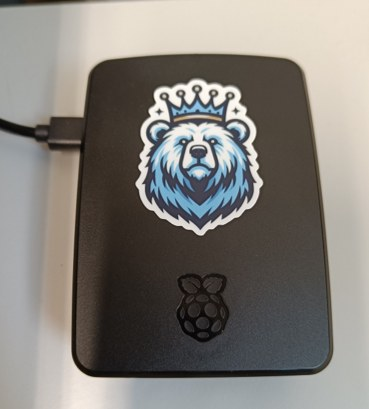

<p align="center"></p>

# OTSOpi

> [!NOTE]
> **A hobby project.** I'm Nicholas Larsen, the developer of
> [OTSO](https://github.com/NLarsen15/OTSOpy), and OTSOpi is a personal side
> project I set up to test whether a **near-real-time database of geomagnetic
> cut-off rigidities** is feasible. Can a single low-cost Raspberry Pi, running
> OTSO on live space-weather data, keep an hourly record for neutron monitors
> around the world up to date and publish it openly? The results are
> experimental and provided as-is. Live inputs are provisional and may differ
> from the final data, and the record may have gaps.


Website: <https://nlarsen15.github.io/OTSOpi/> (key stations) · [all stations](https://nlarsen15.github.io/OTSOpi/stations.html)

Hourly geomagnetic vertical cut-off rigidities for neutron monitor stations,
computed with [OTSO](https://github.com/NLarsen15/OTSOpy) on a Raspberry Pi
using live NOAA/Kyoto/GFZ space-weather inputs.

The stations are listed in [`stations.json`](stations.json). The initial set is:

| Station | OTSO code |
|---|---|
| Oulu | OULU |
| Thule | THUL |
| Lomnický štít | LMKS |
| Moscow (IZMIRAN) | MOSC |

These stations were selected following Mertens et al. (2025):

> Mertens, C. J., Gronoff, G. P., & Phoenix, D. B. (2025). NAIRAS Version 3
> atmospheric ionizing radiation validation: Comparisons to RaD‐X measurements.
> *Space Weather*, 23(4), e2024SW004296.
> [doi:10.1029/2024SW004296](https://doi.org/10.1029/2024SW004296)

### Adding or removing stations

Any station in OTSO's built-in list can be added from the terminal. The command
commits and pushes `stations.json`, and the next hourly run computes the new
station, backfilling the last ~21 h:

```
./station search kiel        # find the OTSO code
./station add KIEL           # add it (name defaults to OTSO's full name: Kiel)
./station remove Kiel        # stop computing it; existing data is kept
./station list
```

Monitors that are not in OTSO's list (e.g. new installations) can be added by
geographic coordinates; they are passed to OTSO as custom locations:

```
./station add-custom Camborne 50.22 -5.32 CAMB   # name, lat (°N), lon (°E), code
```

## Data (`main` branch)

`data/<Station>_cutoff.csv`, one row per hour:

| Column | Meaning |
|---|---|
| `datetime_utc` | Time the cut-off is computed for (UTC, top of the hour) |
| `Ru_GV`, `Rc_GV`, `Rl_GV` | Upper, effective and lower cut-off rigidity (GV) |
| `external_model` | Tsyganenko external field model used |
| `computed_at_utc` | When the row was computed (UTC) |

Each hour is computed 3 hours after the fact so the live input datasets have
updated. Hours missed (e.g. while offline) are backfilled while live data still
covers them (~21 h). Live inputs are provisional and may differ from the final
OMNI values.

Model setup:

- **Field model:** IGRF + TSY01S (storm-time TSY01, optimised) with its built-in
  magnetopause, driven by the live inputs above.
- **Integration model:** Boris-Buneman with an adaptive time step limited to
  1 % of the gyro-period and a 0.001 % energy (β) check. Trajectories start at
  20 km altitude and end on re-entry below 20 km, escape through the
  magnetopause, or after 100 Rₑ of path.
- **Rigidity scan:** 20 → 0 GV in 0.01 GV steps (vertical incidence).

### Asymptotic viewing directions

`data/asymptotic/<Station>/<YYYY-MM>.csv`, one row per hour, one column per
rigidity level (`1GV` … `100GV`, 65 levels: 0.1 GV steps below 2 GV, widening
to 5 GV steps above 50 GV). Each cell is `filter;latitude;longitude` as output
by OTSO: the filter code for that trajectory, and the asymptotic direction in
GEO coordinates (degrees, 0.01° precision). Same hours and inputs as the
cut-off files.

### Model inputs

`data/inputs.csv`, one row per hour (shared by all stations): the inputs OTSO
used, as reported by OTSO after its own processing of the live data.

| Column | Meaning |
|---|---|
| `Kp`, `IOPT` | Kp index and the Tsyganenko IOPT derived from it |
| `Vx_kms`, `Vy_kms`, `Vz_kms` | Solar wind velocity (km/s) |
| `Bx_nT`, `By_nT`, `Bz_nT` | IMF components (nT; Bx is the 30-min average OTSO passes on) |
| `By_avg30_nT`, `Bz_avg30_nT` | 30-min averaged IMF By, Bz (nT) |
| `density_cm3`, `Pdyn_nPa` | Solar wind density (cm⁻³) and dynamic pressure (nPa) |
| `Dst_nT` | Dst index (nT) |
| `G1`, `G2`, `G3` | Tsyganenko G parameters |
| `W1`–`W6`, `N_index`, `B_index`, `SYMH_nT` | Inputs for other Tsyganenko models (0 when not used) |
| `data_source`, `external_model`, `otso_version`, `computed_at_utc` | Provenance |

## Website (GitHub Pages)

<https://nlarsen15.github.io/OTSOpi/> has two pages:

- **Key stations** (landing page): the four stations of Mertens et al. (2025),
  marked `"featured": true` in `stations.json`. It shows 7-day hourly and daily-average
  plots, and the asymptotic-direction map with a time slider.
- **All stations**: an overview table of every station (latest Ru/Rc/Rl,
  24-hour change, 7-day range) sorted by cut-off, an interactive cut-off chart for
  any station (7 days hourly or daily averages), and the asymptotic-direction map
  for all stations, with each one switchable on or off.

The site is built by a GitHub Action (`.github/workflows/plots.yml`) each time
new data is pushed. It draws the figures and writes `cutoffs.json` and
`asymptotic.json` for the interactive charts. No images are committed, so the
history stays small. One-time setup: Settings → Pages → Source:
**GitHub Actions**.

## The OTSOpi



Everything is computed by a Raspberry Pi 5 running around the clock:

| | |
|---|---|
| Board | Raspberry Pi 5 Model B (quad-core Arm Cortex-A76, 2.4 GHz) |
| Memory | 8 GB |
| Storage | 64 GB microSD |
| OS | Ubuntu Server 24.04.5 LTS (64-bit) |
| Software | Python 3.12, OTSO 1.3.8 (1 process × 4 threads) |
| Schedule | systemd timer at :05 past every hour (+ :35 retry), and 3 min after boot |

**Time per hour** (cut-off scan 20 → 0 GV in 0.01 GV steps plus asymptotic
directions at 65 rigidities, per station):

| Stations | Time per hour |
|---|---|
| 15 | ≈ 1 min (median 54 s, range 49–79 s) |
| 4 | ≈ 30 s |
| none missing (:35 check) | ≈ 2 s |

Backfilling after an outage runs at the same rate: 19 hours for 15 stations took
about 18 minutes. Each extra station adds roughly 3 s per hour (measured 11 Oct 2026).

<br clear="right">

## Running

- `hourly_cutoff.py` computes and appends to `data/`.
- `plot_cutoffs.py OUT_DIR` writes the plots (run by the Action; needs only
  `requirements-plots.txt`, not OTSO).
- `run_hourly.sh` is the cron/systemd entry point: compute, commit and push.
  Logs go to `~/.local/state/nm-cutoffs/run.log`.
- `./station` manages the station list (`stations.py`, `stations.json`).
- `bench_cores.py` picks `corenum`/`threadnum` for the machine.

```
5,35 * * * * /path/to/OTSOpi/run_hourly.sh
```

The :35 run is a quick retry: it does nothing unless an hour is missing (e.g. after a
network dropout). If the live data can't be downloaded, a run stops at the first
failure and leaves the remaining hours for the next run.

## License

GPL-3.0, see [LICENSE](LICENSE).
